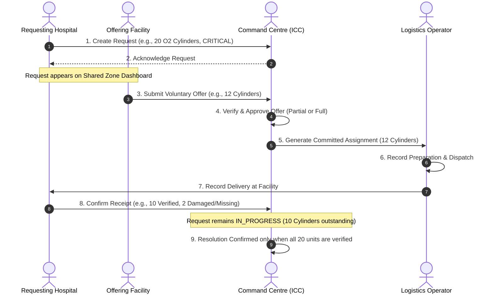
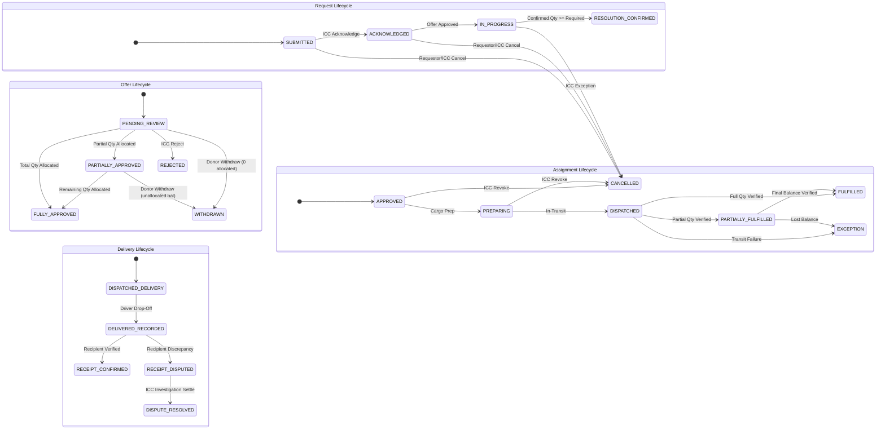
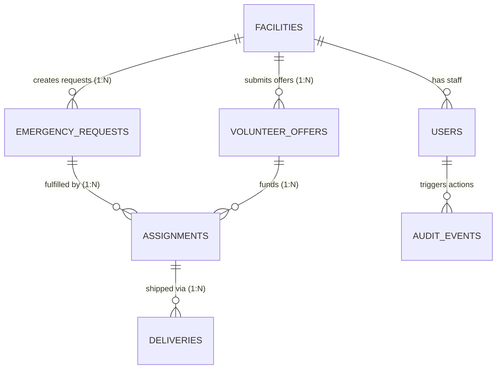

# Product Requirements Document (PRD)
# EDITH: Disaster-Response Healthcare Coordination Platform

**Document Version:** 1.0.0  
**Status:** Approved for Implementation Planning  
**Last Updated:** October 2026  
**Target Environment:** Disaster Zones (Floods, Cyclones, Intermittent Connectivity)

---

## 1. Executive Summary

During natural disasters such as catastrophic floods and cyclones, healthcare infrastructure faces acute supply shortages alongside severed or degraded communication channels. The primary bottleneck is rarely a total absence of regional aid, but an acute failure of coordination: fragmented phone calls, unmonitored WhatsApp/SMS groups, stale paper manifests, unacknowledged requests, and ambiguous responsibility.

**EDITH** is a software-only, offline-aware healthcare emergency coordination platform. It connects authorized hospitals, medical relief camps, and an Incident Command Centre (ICC) to manage emergency resource requests, voluntary offers, approved assignments, transit progress, and receipt-verified delivery.

### What EDITH Is
* **Request-Centric:** Facilities broadcast specific urgent needs; peers volunteer what they can spare.
* **Human-Controlled:** An Incident Command Centre validates offers, authorizes assignments, mediates disputes, and formally confirms resolution.
* **Offline-Aware:** Disconnected devices can draft requests, log deliveries, and queue sync operations in local storage (IndexedDB), with clear visual distinction between local drafts and server-confirmed records.
* **Accountable & Auditable:** Every lifecycle change records who, when, and what changed. Partial deliveries and discrepancies are managed through formal verification.

### What EDITH Is NOT
* **Not an Inventory Management System:** Facilities are never required to expose or maintain full inventory records.
* **Not an Automated Dispatch Engine:** The platform does not perform algorithmic matching or autonomous vehicle dispatch.
* **Not a Patient Electronic Health Record (EHR):** No patient-identifiable data or clinical triage information is collected or stored.
* **Not a Peer-to-Peer Mesh Network:** Disconnected devices cannot sync directly with other disconnected devices without server mediation.

---

## 2. Core Problem & Disaster Context

### 2.1 Environmental Realities
* **Communication Disruptions:** Cellular towers lose power or become congested; fiber backhauls are severed. Connectivity is intermittent, degraded, or absent for hours.
* **Rapid Resource Depletion:** Surge trauma, water-borne disease, and power outages cause sudden critical shortages in medical gases (oxygen), IV fluids, antibiotics, vaccines, and emergency power/generators.
* **Information Chaos:** Multiple stakeholders place duplicate requests across informal channels. Suppliers dispatch goods without knowing if another donor already fulfilled the need, leading to surplus in some camps and critical shortages in others.

### 2.2 Core Product Principles
1. **Request-Centric, Not Inventory-Centric:** Hospitals retain sovereignty over their general stock. Only voluntary contributions are registered in response to active emergencies.
2. **Human Coordination:** Machine algorithms do not make rationing or dispatch decisions. Human coordinators retain final authority over assignments and exception handling.
3. **Strict Truth in Offline State:** Local records are never misrepresented as central server truth. Un-synced records are visually marked as "Queued Locally".
4. **Non-Repudiation and Verification:** A delivery driver marking "Delivered" does not close a request. Fulfillment requires recipient receipt confirmation.
5. **Data Minimization:** Strictly zero Patient Health Information (PHI/PII). Operational coordination only.

---

## 3. Users, Personas & Role-Based Permissions (RBAC)

Permissions are enforced strictly by the backend API and database layer, not merely hidden in the UI.

```
┌────────────────────────────────────────────────────────────────────────┐
│                        ROLE PERMISSIONS MATRIX                         │
├────────────────────────────┬──────────────┬──────────────┬─────────────┤
│ Capability                 │ Hospital /   │ Incident     │ Logistics   │
│                            │ Camp User    │ Command (ICC)│ Operator    │
├────────────────────────────┼──────────────┼──────────────┼─────────────┤
│ Create Emergency Request   │  OWN FACILITY│      YES     │     NO      │
│ Cancel Request             │  OWN FACILITY│      YES     │     NO      │
│ View Shared Requests       │      YES     │      YES     │     YES     │
│ Submit Voluntary Offer     │  OWN FACILITY│      YES     │     NO      │
│ Withdraw Offer (Unallocated│  OWN FACILITY│      YES     │     NO      │
│ Acknowledge Request        │      NO      │      YES     │     NO      │
│ Approve Offer & Assign Qty │      NO      │      YES     │     NO      │
│ Reject Offer               │      NO      │      YES     │     NO      │
│ Log Cargo Preparation      │  DONOR FACIL │      YES     │     YES     │
│ Record Dispatch & Transit  │      NO      │      YES     │     YES     │
│ Record Physical Drop-Off   │      NO      │      YES     │     YES     │
│ Confirm Receipt / Dispute  │  RECIPIENT   │      YES     │     NO      │
│ Resolve Delivery Dispute   │      NO      │      YES     │     NO      │
│ Confirm Request Resolution │      NO      │      YES     │     NO      │
│ View System Audit Trail    │   RESTRICTED │   FULL AUDIT │  RESTRICTED │
└────────────────────────────┴──────────────┴──────────────┴─────────────┘
```

### 3.1 Role Descriptions
* **Hospital / Medical Camp User (`HOSPITAL_USER`):** Frontline doctors, nurses, or facility administrators. They report emergency needs, view open needs across the disaster zone, volunteer spare resources, and inspect incoming deliveries.
* **Incident Command-Centre Coordinator (`ICC_COORDINATOR`):** Central emergency managers. They triage incoming requests, evaluate volunteer offers, authorize assignments, allocate partial quotas, adjudicate delivery disputes, and sign off on request closure.
* **Logistics Operator (`LOGISTICS_OPERATOR`):** Relief drivers, ambulance fleet managers, and warehouse dispatchers. They manage packaging, record transporter/vehicle identifiers, provide transit updates, and log drop-offs.

---

## 4. End-to-End Operational Lifecycle & Workflows



### 4.1 Step-by-Step Workflow Rules

1. **Step 1: Emergency Request Creation**
   - The requesting facility creates a request: Resource name, unit of measure, quantity required ($> 0$), urgency (`LOW`, `MEDIUM`, `HIGH`, `CRITICAL`), and operational context (e.g., "ICU back-up depleted due to power failure").
   - A unique client-generated UUID (`client_id`) is attached to prevent duplicate creation over flaky networks.
   - Status initialized to `SUBMITTED`.

2. **Step 2: Command Acknowledgement**
   - ICC Coordinator verifies the request is genuine and operational.
   - Status transitions from `SUBMITTED` to `ACKNOWLEDGED`.
   - The request becomes visible to all authorized participating facilities across the coordination zone.

3. **Step 3: Voluntary Offer Submission**
   - A peer facility with surplus or available resources submits a voluntary offer.
   - The offer can optionally target a specific request or remain a general pledge for a resource type.
   - Initial status: `PENDING_REVIEW`.

4. **Step 4: Coordinator Review & Offer Approval**
   - The ICC coordinator verifies logistics feasibility and approves either the full offered quantity or a partial quantity.
   - Partial allocation (Option A) is supported: If an offer is for 10 units, but the request only requires 6, the coordinator approves 6. The offer status transitions to `PARTIALLY_APPROVED`, leaving 4 units available for other assignments or donor withdrawal.

5. **Step 5: Assignment Commitment Creation**
   - Approving an offer atomically creates an `Assignment` record linking Request, Offer, and the specific committed quantity.
   - The parent Request automatically transitions to `IN_PROGRESS`.
   - **Hard Invariant:** The sum of active commitments can never exceed the remaining required quantity.

6. **Step 6: Logistics Preparation & Dispatch**
   - Logistics operators or donor personnel prepare the cargo and log transporter details (driver name, phone, vehicle plate number, route notes).
   - Assignment transitions to `PREPARING` and then `DISPATCHED`.

7. **Step 7: Physical Drop-off Logging**
   - The transporter delivers the goods to the recipient facility and logs `DELIVERED_RECORDED`.
   - **Crucial Rule:** The assignment is NOT yet fulfilled.

8. **Step 8: Receipt Verification & Dispute Logging**
   - The receiving facility physically inspects the delivered items:
     - **Full Receipt:** Confirms exact quantity. Status becomes `RECEIPT_CONFIRMED`.
     - **Discrepancy / Damage:** Notes missing units or damage (e.g., 10 received, 2 damaged). Status becomes `RECEIPT_DISPUTED`.
   - The ICC coordinator investigates disputes, contacts parties, and sets the authoritative confirmed quantity (`DISPUTE_RESOLVED`).

9. **Step 9: Resolution Confirmation**
   - A request can be fulfilled through multiple offers and assignments from different facilities.
   - The ICC coordinator confirms resolution (`RESOLUTION_CONFIRMED`) **only when** total confirmed delivered quantity meets or exceeds the required quantity.

---

## 5. State Machine Specifications

Each core business entity possesses an independent lifecycle.



---

## 6. Mathematical Invariants & Integrity Constraints

The system mathematically enforces the following business invariants:

### Invariant 1: The Triple-Book Quantity Equation
For any Emergency Request:
$$\text{Remaining Requirement} = \text{quantity\_required} - \text{quantity\_delivered\_confirmed}$$
$$\text{Active Committed Quantity} = \sum_{\text{status} \notin \{\text{'CANCELLED'}, \text{'EXCEPTION'}\}} \text{assignment.assigned\_quantity}$$
$$\text{Active Committed Quantity} \le \text{Remaining Requirement}$$

### Invariant 2: Offer Allocation Ceiling
For any Volunteer Offer:
$$\text{Allocated Quantity} = \sum_{\text{status} \neq \text{'CANCELLED'}} \text{assignment.assigned\_quantity}$$
$$\text{Allocated Quantity} \le \text{quantity\_offered}$$
$$\text{Available to Withdraw} = \text{quantity\_offered} - \text{Allocated Quantity}$$

### Invariant 3: Concurrency Isolation Protocol
During offer approval and commitment creation, PostgreSQL row-level locks are acquired in consistent order:
1. `SELECT * FROM emergency_requests WHERE id = :req_id FOR UPDATE;`
2. `SELECT * FROM volunteer_offers WHERE id = :offer_id FOR UPDATE;`
3. Execute validation calculations inside the serializable transaction block.
4. Commit or Rollback.

---

## 7. Relational Data Model & ERD

### 7.1 Cardinality Principles
* **Facility $\to$ Requests ($1:N$):** A facility can submit multiple concurrent and historical emergency requests.
* **Facility $\to$ Offers ($1:N$):** A facility can submit multiple concurrent volunteer offers.
* **Facility $\to$ Users ($1:N$):** Multiple staff members belong to a facility.
* **Request $\to$ Assignments ($1:N$):** A request can be fulfilled by multiple assignments from different donor facilities.
* **Offer $\to$ Assignments ($1:N$):** An offer can be partitioned across multiple assignments.
* **Assignment $\to$ Deliveries ($1:N$):** An assignment can be delivered in multiple physical shipments.



### 7.2 Database Schema Definition (PostgreSQL 16)

```sql
-- 1. FACILITIES
CREATE TABLE facilities (
    id UUID PRIMARY KEY DEFAULT gen_random_uuid(),
    name VARCHAR(150) NOT NULL,
    facility_type VARCHAR(50) NOT NULL CHECK (facility_type IN ('HOSPITAL', 'CLINIC', 'RELIEF_CAMP', 'COMMAND_CENTRE')),
    latitude NUMERIC(9,6),
    longitude NUMERIC(9,6),
    address TEXT NOT NULL,
    contact_person VARCHAR(100) NOT NULL,
    contact_phone VARCHAR(50) NOT NULL,
    is_active BOOLEAN NOT NULL DEFAULT TRUE,
    created_at TIMESTAMPTZ NOT NULL DEFAULT NOW(),
    updated_at TIMESTAMPTZ NOT NULL DEFAULT NOW()
);

-- 2. USERS
CREATE TABLE users (
    id UUID PRIMARY KEY DEFAULT gen_random_uuid(),
    facility_id UUID NOT NULL REFERENCES facilities(id) ON DELETE RESTRICT,
    username VARCHAR(50) UNIQUE NOT NULL,
    hashed_password VARCHAR(255) NOT NULL,
    full_name VARCHAR(100) NOT NULL,
    phone VARCHAR(50),
    role VARCHAR(30) NOT NULL CHECK (role IN ('HOSPITAL_USER', 'ICC_COORDINATOR', 'LOGISTICS_OPERATOR')),
    is_active BOOLEAN NOT NULL DEFAULT TRUE,
    created_at TIMESTAMPTZ NOT NULL DEFAULT NOW(),
    updated_at TIMESTAMPTZ NOT NULL DEFAULT NOW()
);

-- 3. EMERGENCY REQUESTS (1 Facility -> Many Requests)
CREATE TABLE emergency_requests (
    id UUID PRIMARY KEY DEFAULT gen_random_uuid(),
    client_id UUID UNIQUE NOT NULL, -- Client-generated idempotency key
    requesting_facility_id UUID NOT NULL REFERENCES facilities(id) ON DELETE RESTRICT,
    resource_name VARCHAR(100) NOT NULL,
    unit VARCHAR(30) NOT NULL,
    quantity_required INT NOT NULL CHECK (quantity_required > 0),
    urgency VARCHAR(20) NOT NULL CHECK (urgency IN ('LOW', 'MEDIUM', 'HIGH', 'CRITICAL')),
    status VARCHAR(30) NOT NULL DEFAULT 'SUBMITTED' CHECK (status IN ('SUBMITTED', 'ACKNOWLEDGED', 'IN_PROGRESS', 'RESOLUTION_CONFIRMED', 'CANCELLED')),
    operational_notes TEXT,
    created_by_id UUID NOT NULL REFERENCES users(id),
    created_at TIMESTAMPTZ NOT NULL DEFAULT NOW(),
    updated_at TIMESTAMPTZ NOT NULL DEFAULT NOW()
);

-- 4. VOLUNTEER OFFERS (1 Facility -> Many Offers)
CREATE TABLE volunteer_offers (
    id UUID PRIMARY KEY DEFAULT gen_random_uuid(),
    client_id UUID UNIQUE NOT NULL,
    offering_facility_id UUID NOT NULL REFERENCES facilities(id) ON DELETE RESTRICT,
    target_request_id UUID REFERENCES emergency_requests(id) ON DELETE SET NULL,
    resource_name VARCHAR(100) NOT NULL,
    unit VARCHAR(30) NOT NULL,
    quantity_offered INT NOT NULL CHECK (quantity_offered > 0),
    quantity_allocated INT NOT NULL DEFAULT 0 CHECK (quantity_allocated >= 0 AND quantity_allocated <= quantity_offered),
    status VARCHAR(30) NOT NULL DEFAULT 'PENDING_REVIEW' CHECK (status IN ('PENDING_REVIEW', 'PARTIALLY_APPROVED', 'FULLY_APPROVED', 'REJECTED', 'WITHDRAWN')),
    operational_notes TEXT,
    created_by_id UUID NOT NULL REFERENCES users(id),
    created_at TIMESTAMPTZ NOT NULL DEFAULT NOW(),
    updated_at TIMESTAMPTZ NOT NULL DEFAULT NOW()
);

-- 5. ASSIGNMENTS
CREATE TABLE assignments (
    id UUID PRIMARY KEY DEFAULT gen_random_uuid(),
    request_id UUID NOT NULL REFERENCES emergency_requests(id) ON DELETE RESTRICT,
    offer_id UUID NOT NULL REFERENCES volunteer_offers(id) ON DELETE RESTRICT,
    assigned_quantity INT NOT NULL CHECK (assigned_quantity > 0),
    status VARCHAR(30) NOT NULL DEFAULT 'APPROVED' CHECK (status IN ('APPROVED', 'PREPARING', 'DISPATCHED', 'PARTIALLY_FULFILLED', 'FULFILLED', 'CANCELLED', 'EXCEPTION')),
    approved_by_id UUID NOT NULL REFERENCES users(id),
    notes TEXT,
    created_at TIMESTAMPTZ NOT NULL DEFAULT NOW(),
    updated_at TIMESTAMPTZ NOT NULL DEFAULT NOW()
);

-- 6. DELIVERIES
CREATE TABLE deliveries (
    id UUID PRIMARY KEY DEFAULT gen_random_uuid(),
    client_id UUID UNIQUE NOT NULL,
    assignment_id UUID NOT NULL REFERENCES assignments(id) ON DELETE RESTRICT,
    quantity_dispatched INT NOT NULL CHECK (quantity_dispatched > 0),
    quantity_received INT CHECK (quantity_received >= 0),
    status VARCHAR(30) NOT NULL DEFAULT 'DISPATCHED' CHECK (status IN ('DISPATCHED', 'DELIVERED_RECORDED', 'RECEIPT_CONFIRMED', 'RECEIPT_DISPUTED', 'DISPUTE_RESOLVED')),
    transporter_info TEXT NOT NULL,
    discrepancy_reason VARCHAR(50) CHECK (discrepancy_reason IN ('NONE', 'DAMAGED_CARGO', 'SHORT_SHIPMENT', 'WRONG_SPECIFICATION', 'CONTAMINATED', 'LOST_IN_TRANSIT')),
    discrepancy_notes TEXT,
    dispatched_at TIMESTAMPTZ NOT NULL DEFAULT NOW(),
    delivered_at TIMESTAMPTZ,
    confirmed_at TIMESTAMPTZ,
    confirmed_by_id UUID REFERENCES users(id),
    created_at TIMESTAMPTZ NOT NULL DEFAULT NOW(),
    updated_at TIMESTAMPTZ NOT NULL DEFAULT NOW()
);

-- 7. AUDIT EVENTS (Append-Only)
CREATE TABLE audit_events (
    id UUID PRIMARY KEY DEFAULT gen_random_uuid(),
    entity_type VARCHAR(30) NOT NULL CHECK (entity_type IN ('REQUEST', 'OFFER', 'ASSIGNMENT', 'DELIVERY')),
    entity_id UUID NOT NULL,
    actor_user_id UUID NOT NULL REFERENCES users(id),
    action VARCHAR(50) NOT NULL,
    previous_state VARCHAR(50),
    new_state VARCHAR(50) NOT NULL,
    payload_diff JSONB,
    created_at TIMESTAMPTZ NOT NULL DEFAULT NOW()
);

CREATE INDEX idx_requests_status ON emergency_requests(status);
CREATE INDEX idx_requests_facility ON emergency_requests(requesting_facility_id);
CREATE INDEX idx_offers_status ON volunteer_offers(status);
CREATE INDEX idx_assignments_req ON assignments(request_id);
CREATE INDEX idx_deliveries_asgn ON deliveries(assignment_id);
CREATE INDEX idx_audit_entity ON audit_events(entity_type, entity_id);
```

---

## 8. Offline Synchronization & PWA Architecture

### 8.1 Client-Side IndexedDB Storage Architecture
* **`outbox` Store:**
  - Key: `client_id` (UUIDv4)
  - Fields: `endpoint`, `method`, `payload`, `created_at`, `sync_status` (`QUEUED`, `SYNCING`, `FAILED_CONFLICT`)
* **`cached_entities` Store:**
  - Stores server-confirmed requests, facilities, and assignments for offline search and rendering.
* **`auth_vault` Store:**
  - Stores local user profile, facility mapping, active JWT access token, and refresh credentials.

### 8.2 Synchronization Flow & Conflict Resolution
1. **Local Drafting:** When offline, field workers create requests or record receipts. Data is persisted to the local IndexedDB `outbox` with an assigned `client_id`.
2. **Visual Differentiation:** The UI renders offline draft records with a distinct badge:
   - 🟡 **"Queued Locally (Not on Server)"**
   - Destructive or server-dependent actions are locked until synced.
3. **Re-connection & Auth Refresh:**
   - On `navigator.onLine` or network heartbeat recovery, the client verifies session validity.
   - If the access token expired while offline, the background sync manager uses the refresh token to acquire a fresh JWT before attempting mutation calls.
   - If user credentials cannot be refreshed, the UI prompts for credentials before outbox transmission without clearing local data.
4. **Idempotent Batch Submission:**
   - Outbox mutations are transmitted in FIFO order to `/api/v1/sync/batch`.
   - The backend checks `client_id`. If already processed, it returns the existing record idempotently.
5. **Business Conflict Adjudication:**
   - If an operation fails server business validation (e.g., an offer was submitted for a request that was cancelled by the ICC), the outbox item transitions to 🔴 **"Sync Rejected"** with the server's explanation.
   - The user is notified to review or discard the conflicting item. The system never performs silent overwrites.

---

## 9. API Specifications (`/api/v1/`)

### 9.1 Authentication & Facilities
* `POST /api/v1/auth/login`: Authenticate username/password; returns access token (short-lived) + refresh token (long-lived) + user profile.
* `POST /api/v1/auth/refresh`: Refresh expired access token.
* `GET /api/v1/facilities`: List participating healthcare facilities and command centers.
* `GET /api/v1/health`: Liveness and database connectivity verification.

### 9.2 Emergency Requests
* `GET /api/v1/requests`: Filterable, paginated list of active requests (`status`, `urgency`, `facility_id`).
* `POST /api/v1/requests`: Create a new emergency request (Idempotent via `client_id`).
* `GET /api/v1/requests/{id}`: Full request detail including all offers, assignments, and deliveries.
* `POST /api/v1/requests/{id}/acknowledge`: ICC Coordinator acknowledges request (`SUBMITTED` $\to$ `ACKNOWLEDGED`).
* `POST /api/v1/requests/{id}/cancel`: Requestor or ICC cancels request.
* `POST /api/v1/requests/{id}/resolve`: ICC Coordinator confirms resolution (`IN_PROGRESS` $\to$ `RESOLUTION_CONFIRMED`).

### 9.3 Volunteer Offers
* `GET /api/v1/offers`: List offers (filterable by status, facility, target request).
* `POST /api/v1/offers`: Submit voluntary supply offer (Idempotent via `client_id`).
* `POST /api/v1/offers/{id}/approve`: ICC Coordinator approves quantity and generates assignment.
* `POST /api/v1/offers/{id}/reject`: ICC Coordinator rejects offer.
* `POST /api/v1/offers/{id}/withdraw`: Donor facility withdraws unallocated quantity.

### 9.4 Logistics & Verified Delivery
* `POST /api/v1/assignments/{id}/prepare`: Logistics logs cargo preparation.
* `POST /api/v1/assignments/{id}/dispatch`: Logistics logs vehicle departure and tracking metadata.
* `POST /api/v1/deliveries/{id}/record`: Transporter records physical drop-off at destination facility.
* `POST /api/v1/deliveries/{id}/confirm`: Recipient confirms received quantity or submits dispute.
* `POST /api/v1/deliveries/{id}/resolve-dispute`: ICC Coordinator settles dispute with final verified quantity.

### 9.5 Batch Sync & Audit
* `POST /api/v1/sync/batch`: Transactional processing of offline outbox mutation bundles.
* `GET /api/v1/audit`: Append-only event history for operational analysis.

---

## 10. Non-Functional Requirements (NFR)

1. **Resilience & Intermittent Network Tolerance:**
   - Full application bundle loads from Service Worker cache within 1.5 seconds without internet connection.
   - All critical forms function without active connectivity, persisting state to IndexedDB.
2. **Data Consistency & Concurrency:**
   - 100% elimination of over-allocation race conditions via explicit PostgreSQL transaction locks (`SELECT ... FOR UPDATE`).
   - Zero duplicate records created via network retry retries (strict `client_id` deduplication).
3. **Security & Privacy:**
   - Backend-enforced role permissions (FastAPI dependency injection).
   - Passwords hashed with Argon2 or Bcrypt.
   - Strict ban on patient health information or personal medical data.
4. **Auditability:**
   - Immutable append-only audit trail capturing actor, entity, timestamps, and state diffs.
5. **Simplicity & Maintainability:**
   - Modular monolith structure.
   - Standard Vanilla CSS/HTML/JS for the client; Python FastAPI + SQLAlchemy + PostgreSQL for the backend.
   - Zero unnecessary infrastructure (no Kafka, Redis, or microservices).

---

## 11. Implementation Roadmap

| Phase | Title | Core Deliverables |
| :--- | :--- | :--- |
| **Phase 0** | Requirements & Design | PRD, ERD, State Machines, API Specifications, Concurrency Model *(Complete)* |
| **Phase 1** | Foundation | Docker Compose (PostgreSQL 16), FastAPI core app, database session, initial migration, health check, automated tests |
| **Phase 2** | Authentication & Facilities | Facility & User models, password hashing, JWT dual-token auth, RBAC dependencies, seed data |
| **Phase 3** | Emergency Requests | Request domain models, Pydantic schemas, CRUD & state transitions, duplicate prevention |
| **Phase 4** | Volunteer Offers & Assignments | Offer & Assignment models, atomic approval transaction with row locks, allocation limits |
| **Phase 5** | Logistics & Verified Delivery | Delivery model, dispatch logging, recipient receipt confirmation, dispute resolution flow |
| **Phase 6** | Dashboard & Audit History | ICC command dashboard API, active vs unresolved summaries, immutable audit logging |
| **Phase 7** | Offline PWA & Sync Engine | PWA Service Worker, IndexedDB outbox, FIFO sync engine, conflict notifications, UI offline indicators |
| **Phase 8** | Verification, Deployment & Demo | End-to-end integration test suite, disaster simulation scenarios, deployment scripts, demo data |

---

## 12. Sign-off & Approval Gate

This PRD serves as the authoritative blueprint for EDITH. Implementation will proceed phase-by-phase upon explicit approval.

* **Architectural Review:** Completed  
* **Schema & State Review:** Completed  
* **Approval Status:** Ready for Phase 1 Execution Initiation
